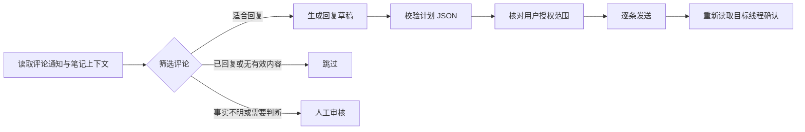

# 小红书评论回复增强版

为自己的小红书笔记筛选评论、生成自然回复，并在用户授权后逐条发送与核验的 AI 助手 Skill。

A reusable AI assistant skill for contextual Xiaohongshu comment replies, with draft review, duplicate checks and verification after sending.

## 工作流程



默认生成草稿。确认发送模式和自动发送模式都需要用户明确授权相应范围；校验通过本身不代表获得发送许可。

## 增强功能

- 从评论通知进入对应笔记，结合正文与完整评论线程判断。
- 线程已有作者回复时跳过，避免重复回复。
- 回复结合具体语境，减少客服模板、重复句式和未经提供的个人经历。
- 默认跳过住宿推荐，投诉、合作、价格承诺及事实不明的问题进入人工审核。
- 每批最多 10 条；发送前检查计划字段、重复 ID、重复回复和长度。
- 同一次任务锁定同一个浏览器会话，避免因工具超时而反复切换浏览器、重复登录。
- 发送后读取目标线程中的作者回复；结果不明确时先核实，避免重复提交。

## 安装

需要支持 `SKILL.md` 的 AI 助手。实际读取和回复还需要可用且已登录的小红书浏览器会话，或支持相应接口的 MCP 工具。具体工具由运行环境提供。

将本仓库完整放在助手支持的技能目录中。例如 Codex 的用户级技能目录可使用 `~/.agents/skills/xiaohongshu-human-comment-reply/`。已有同名安装时，先保留原目录，再自行选择更新方式。

Windows PowerShell：

```powershell
git clone https://github.com/shangguanyiyu0011/xiaohongshu-human-comment-reply.git "$env:USERPROFILE\.agents\skills\xiaohongshu-human-comment-reply"
```

macOS / Linux：

```bash
git clone https://github.com/shangguanyiyu0011/xiaohongshu-human-comment-reply.git ~/.agents/skills/xiaohongshu-human-comment-reply
```

按宿主的技能加载方式启用或重新打开对话。只运行本地校验脚本需要 Python 3.10+，无第三方 Python 依赖。

## 怎么使用

先审阅草稿：

> 用小红书评论回复增强版，查看我最近 24 小时笔记的评论，先给回复草稿，不发送。

确认本批后执行：

> 按我刚才确认的清单逐条发送，发送后回读对应线程，结果不明确时先核实。

授权指定范围的自动处理：

> 处理最近 24 小时内尚未回复的低风险评论，每批最多 10 条，自动发送；合作、投诉和事实不明的问题留给我审核。

上面的语句是用法示例，不构成对任何账号的实际发送授权。

## 本地校验演示

仓库附有三条明确虚构的示例：一条回复草稿、一条跳过项、一条待审项。`demo-*` 是演示编号；执行真实任务时必须使用现场读取的评论标识和上下文。

```bash
python scripts/validate_reply_plan.py examples/reply-plan.demo.json
```

实际输出：

```text
OK: 3 items validated; 1 reply drafts passed mechanical checks (not sent)
```

校验器只读取本地 JSON，不连接小红书。它检查字段类型、动作、重复 ID、作者已有回复、上下文、空值及重复回复；通常建议回复 8–45 字，硬性上限是 80 个字符。事实准确性、语境和用户授权需要由执行助手核对。

## 测试

```bash
python -m unittest discover -s tests -v
python scripts/test_browser_session_contract.py
```

测试仅使用虚构数据与临时文件，不登录账号或发送评论。测试范围见 [TEST_REPORT.md](TEST_REPORT.md)。

## 文件结构

```text
SKILL.md                         主流程与执行约定
agents/openai.yaml               技能展示信息
references/reply-style.md        回复写法
references/pinned-discussion.md  置顶与讨论写法
references/upstream.md           上游来源与本地增强
scripts/validate_reply_plan.py   本地计划校验器
examples/reply-plan.demo.json    虚构示例
tests/                          校验器回归测试
```

公开包只包含通用技能、文档、代码与虚构示例。真实评论计划、账号数据、Cookie、登录态和本机配置应保存在仓库之外；`.gitignore` 提供常见排除项。

## 来源与许可

本项目在两个 MIT 上游项目的相关方法与工具接口约定基础上整合增强，具体来源、版权与本地修改见 [THIRD_PARTY_NOTICES.md](THIRD_PARTY_NOTICES.md)。新增内容采用 [MIT License](LICENSE)。
